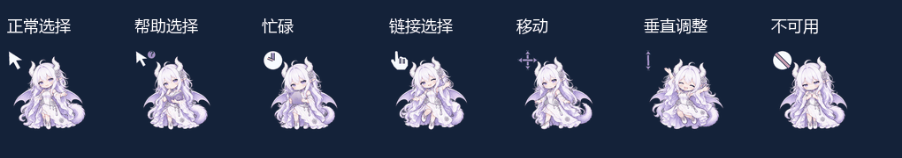
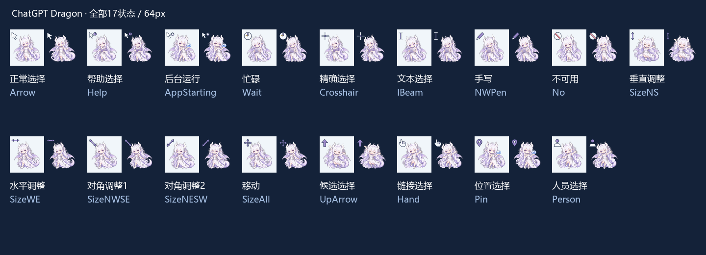

# ChatGPT 龙娘动态鼠标指针

> **v1.0.1 安装兼容修复**：[完整安装包](https://github.com/nibushiyigeren123-bot/chatgpt-dragon-cursors/releases/download/v1.0.1/chatgpt-dragon-cursors-install-v1.0.1.zip) · [可编辑源码](https://github.com/nibushiyigeren123-bot/chatgpt-dragon-cursors/releases/download/v1.0.1/chatgpt-dragon-cursors-source-v1.0.1.zip) · [PNG帧](https://github.com/nibushiyigeren123-bot/chatgpt-dragon-cursors/releases/download/v1.0.1/chatgpt-dragon-cursors-png-frames-v1.0.1.zip)。升级步骤和旧系统说明见 [兼容修复说明](WIN10_COMPATIBILITY.md)。


白发、双角、淡紫龙翼和龙尾的社区 Q 版龙娘，制作成 Windows 传统 ANI 动态指针。**17 种状态 × 32 / 48 / 64 / 128 / 256 px 五档尺寸**，默认安装不运行常驻后台。





## 下载和安装

从 [Releases](https://github.com/nibushiyigeren123-bot/chatgpt-dragon-cursors/releases/latest) 下载 `chatgpt-dragon-cursors-install-v1.0.1.zip`，完整解压，双击 `应用_ChatGPT龙娘_64px.cmd`。需要其他尺寸时双击对应 CMD。

也可右键相应 INF 文件安装，再到 Windows 鼠标属性 → 指针选择对应方案。CMD 会直接应用所选尺寸，并保存安装前设置；`恢复安装前指针.cmd` 可恢复之前的选择。

这是传统 ANI 版本，角色与功能符号在同一光标中。提示框或输入法候选框可能被角色遮挡；本版不提供自动避让，也不附带尺寸保持后台。Windows 指针大小滑块或系统刷新可能调整实际大小，此时重新运行所需尺寸 CMD。

## 动画与编辑

动作由九张生成姿态加八相位二维微动合成，保留标准功能符号与固定点击热点。行走、跳跃等为姿态与二维摆动组合，不是八张独立绘制的步态。

- 安装包：85 个 ANI、五档安装入口与恢复脚本。
- 源码包：透明动作源、选定原稿、参数、Python 构建器与安装脚本。
- PNG 帧包：680 张可编辑合成帧，安装无需下载。

安装 Python 依赖 `requirements.txt` 后，运行 `python source/build_cursors.py` 可重建全部 ANI 和 PNG 帧。

## 来源

依据用户提供的 ChatGPT 龙娘设定参考制作 Q 版动作。参考图片带有知乎署名 `@光影随云飞`，尚未独立核实原作者身份和完整授权；并非 OpenAI 官方角色。本项目不把代码许可扩大为角色或品牌标识的许可，具体记录见 [ASSET_LICENSE.md](ASSET_LICENSE.md)。

## 演示视频与海报

- [39 秒完整介绍](previews/introduction-bilibili.mp4)：17 状态总览、分组大图、五档实际尺寸与传统版安装方法。
- [21 秒简短演示](previews/showcase.mp4)：角色、17 状态与五档尺寸。
- [16:9 海报](previews/poster-16x9.png)（2560×1440） · [4:3 海报](previews/poster-4x3.png)（2400×1800）。
- [B站标题、简介、时间目录与置顶评论](B站投稿文案.md)；SRT 字幕随视频附上。

海报沿用 DeepSeek 原系列版式，Codex 制作本版淡紫配色与文案，HTML 源文件保存在 `source/poster-*.html`。视频使用 MusMus / watson《放課後アフタースクール》作为背景音乐，署名见投稿文案。完整音频、无字幕画面、字幕和场景工程保存在本地正式档案。
